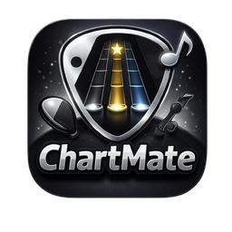
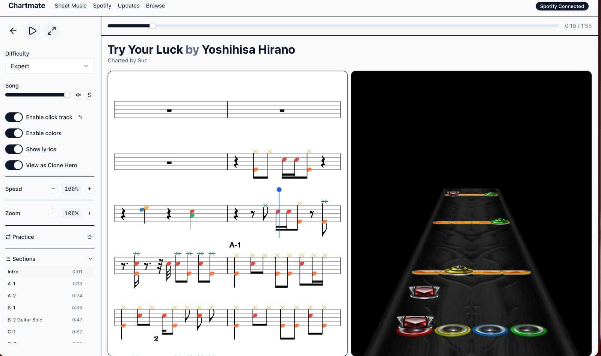
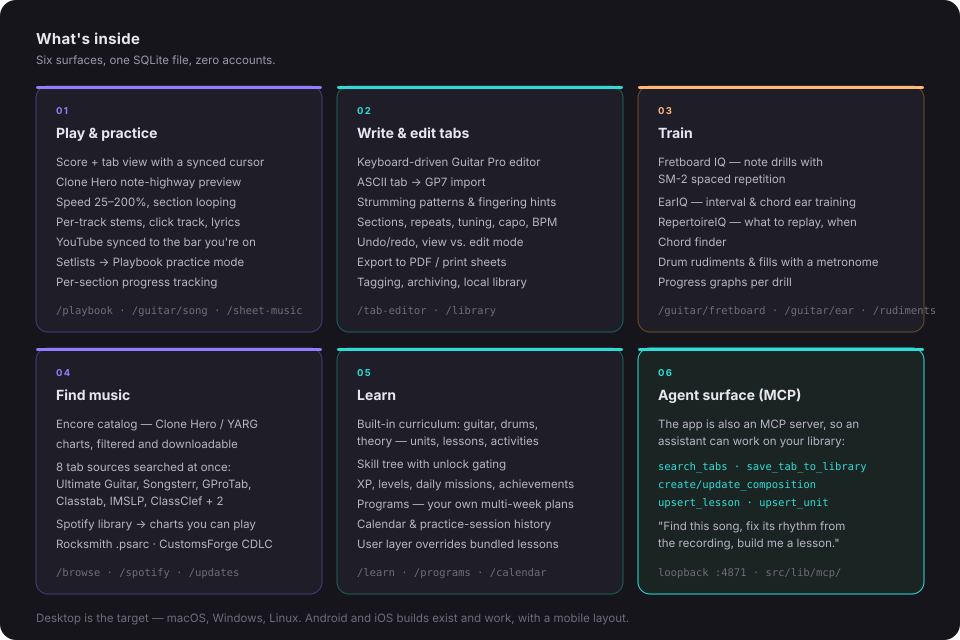
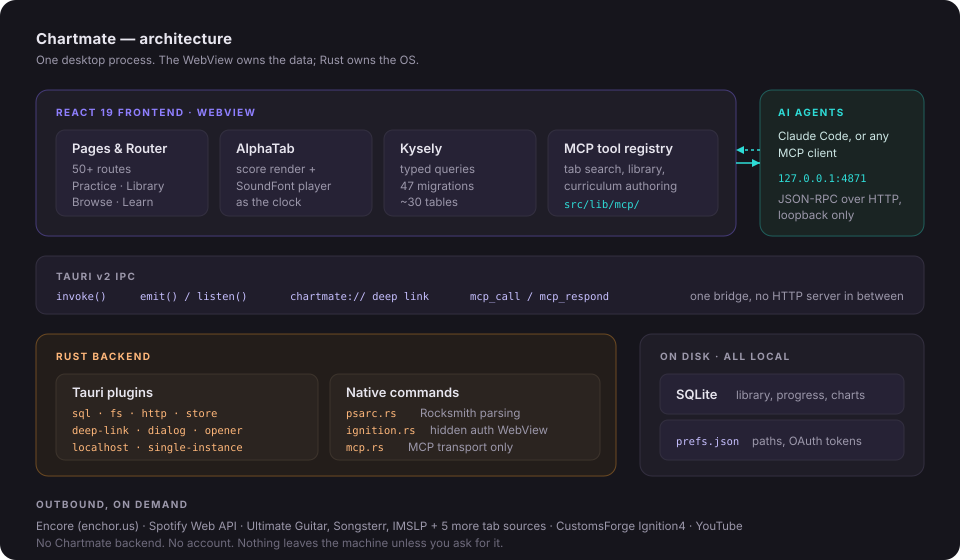

<div align="center">



# Chartmate

**A local-first practice room for guitar and drums.**<br/>
Find the music, read it, slow it down, loop the hard bar, and keep a record of what you actually practiced — in one desktop app that owns its own data.

[](https://v2.tauri.app/)
[](https://react.dev/)
[](https://rustup.rs/)
[](https://sqlite.org/)
[](#the-app-is-also-an-mcp-server)
[](#ai-disclosure)



</div>

---

## What it is

Chartmate started as a chart browser for [Clone Hero](https://clonehero.net/) and [YARG](https://yarg.in/). It grew into the thing I actually wanted: a single app where a song goes from *"I'd like to play that"* to *"I can play that"* without ever leaving the window.

It searches eight tab sites and the Encore chart catalog, renders what it finds as real notation, plays it back with a cursor you can follow, loops any section at any speed, lets you fix or write the tab yourself, and tracks what you drilled and when. Everything lives in one SQLite file on your machine. There is no Chartmate account, no Chartmate server, and nothing is uploaded.

**Who it's for:** people who practice from tabs and charts and are tired of juggling a browser tab, a PDF, a YouTube video at 0.75×, and a notebook.

---

<a id="ai-disclosure"></a>

## ⚠️ About the code (please read)

**This project was built largely with AI coding agents** — Claude Code in particular, with the usual cast of models doing most of the typing. I directed it, reviewed a lot of it, and shipped it, but I did not hand-write most of this codebase and I am not going to pretend otherwise.

What that means, concretely:

- **Don't read this as a sample of my engineering.** It's a sample of what I wanted to exist, and of what agent-driven development produces when the goal is "a working app for me" rather than "a codebase I'd defend in review."
- **Code quality is uneven.** Some modules are tested and deliberate (the tab editor's playback logic, the ASCII importer, the migration layer). Others are first-draft and survived only because they worked. There are duplicate routes, dead paths, inconsistent conventions, and comments written by something that was guessing.
- **Nothing here is load-bearing for anyone but me.** No security review, no audit, no stability promise.
- **Reviews and issues are genuinely welcome**, and so are "why on earth is this like that" questions. The answer is often "an agent wrote it and it passed."

The commit history, the plan and spec files under `docs/superpowers/`, and the agent guide at the repo root are all artifacts of that workflow and left in on purpose — they're the honest record of how this was built.

---

## What's inside

<div align="center">
  
</div>

### Play &amp; practice

Charts and Guitar Pro files render as notation *and* tab with a synced playback cursor. Drum charts can also be shown as a Clone Hero note highway, which is the whole reason this app exists. You get speed 25–200 % that never touches the file, section looping by bar range, per-track stems, a click track, and — if the song has a linked YouTube video — playback synced to the bar you're sitting on. Setlists feed **Playbook**, a practice mode that walks a list of songs and remembers per-section progress and per-item speed.

### Write &amp; edit tabs

A keyboard-driven Guitar Pro editor with undo/redo, an explicit view-vs-edit mode so you can't fat-finger a note while practicing, ASCII-tab import that converts those plain-text tabs from the 2000s into real GP7 scores, strumming patterns, fingering hints, sections, tuning, capo and tempo — and PDF export when you want paper.

### Train

- **Fretboard IQ** — note-location drills backed by an SM-2 spaced-repetition scheduler, with landmark mnemonics and a daily review queue.
- **EarIQ** — interval and chord recognition, with progress tracking and recommendations.
- **RepertoireIQ** — spaced repetition for *songs*, so the thing you learned in March doesn't quietly rot.
- **Rudiments &amp; Fills** — drum practice pages with a metronome and notation.
- **Chord Finder** — shapes and voicings.

### Find music

One search across [Ultimate Guitar](https://www.ultimate-guitar.com/), [Songsterr](https://www.songsterr.com/), GProTab, Classtab, [IMSLP](https://imslp.org/), ClassClef, TheGuitarLesson and ClassicalGuitarShed — plus the [Encore](https://enchor.us) catalog for Clone Hero / YARG charts, CustomsForge Ignition4 for Rocksmith CDLC, and local `.psarc` parsing. Connect Spotify and it'll tell you which songs in your library already have charts. **Updates** compares your local chart folder against Encore and finds newer versions.

### Learn

A bundled curriculum for guitar, drums and theory — units, lessons and activities, arranged in a skill tree with unlock gating — plus XP, levels, daily missions and achievements, because apparently that's what makes me practice. **Programs** are your own multi-week plans; **Calendar** is the record of what you actually did. Bundled lessons are compiled into the app and read-only, but a user layer on disk overrides them by id, so you can replace any lesson and delete your file to get the original back.

### The app is also an MCP server

Chartmate exposes its library and curriculum over the [Model Context Protocol](https://modelcontextprotocol.io/) on `127.0.0.1:4871`, loopback only, while the app is running. Point an MCP client at it and an assistant can do real work on your library:

| Tool | What it does |
|---|---|
| `search_tabs` / `save_tab_to_library` | Search the eight tab sources, pull one in as Guitar Pro |
| `search_charts` | Search the Encore Clone Hero / YARG catalog |
| `create_composition` / `update_composition_score` | Write a transcription into the library |
| `update_composition_meta` | Title, artist, tempo, YouTube link, thumbnail |
| `upsert_lesson` / `upsert_unit` | Author curriculum that shows up in the app |

The transport is Rust ([`src-tauri/src/mcp.rs`](src-tauri/src/mcp.rs)); the tools are TypeScript ([`src/lib/mcp/`](src/lib/mcp/)) because the WebView is the only process allowed to write the SQLite file. Real tasks this unlocks: *"find a tab for this song, work out its actual rhythm from the recording, and build me a lesson around it"* — the skills under `.claude/skills/` do exactly that.

---

## Getting started

### Prerequisites

| | |
|---|---|
| [Rust](https://rustup.rs/) | stable |
| [Node.js](https://nodejs.org/) | 18+ |
| [pnpm](https://pnpm.io/) | any recent |
| Platform deps | [Tauri v2 prerequisites](https://v2.tauri.app/start/prerequisites/) for your OS |

### Run it

```bash
git clone https://github.com/aenrione/chartmate.git
cd chartmate
pnpm install
pnpm tauri dev
```

> [!NOTE]
> `pnpm dev` alone will **not** work — the app talks to SQLite and the filesystem through Tauri, so it needs the native shell. Always use `pnpm tauri dev`.

### Build

```bash
pnpm tauri build          # desktop bundle → src-tauri/target/release/bundle/
pnpm android:build        # Android APK (debug)
pnpm ios:build            # iOS (debugging export)
```

### Optional configuration

| Variable | Needed for |
|---|---|
| `VITE_SPOTIFY_CLIENT_ID` | Spotify library matching. Everything else works without it. |

### First launch

Chartmate asks for your Clone Hero / YARG songs folder. That's used for scanning your local charts, downloading new ones, and checking for updates. Skip it and the chart features stay quiet; the tab, training and curriculum features don't need it.

**Spotify** is opt-in: click *Connect Spotify*, authorize in your browser, and the callback comes back through the `chartmate://` deep link. Tokens are stored locally in `prefs.json`. Scopes are read-only.

---

## How it fits together

<div align="center">
  
</div>

The short version: **the WebView owns the data, Rust owns the OS.** All database access goes through Kysely in TypeScript; Rust exists for the things a WebView can't do — parsing Rocksmith archives, driving a hidden auth WebView to download CDLC, serving the MCP port, and handling deep links. There's no global state library: state is local, or in a React context.

```
chartmate/
├── src/
│   ├── pages/            # one folder per surface — playbook, tab-editor, learn, guitar, …
│   ├── components/       # shared UI, shadcn-style primitives in ui/
│   ├── lib/
│   │   ├── local-db/     # Kysely client, models, 47 migrations
│   │   ├── tab-editor/   # score operations, ASCII import, keyboard engine
│   │   ├── tab-sources/  # the eight scrapers
│   │   ├── mcp/          # MCP tool definitions
│   │   └── curriculum/   # lesson loader + user override layer
│   ├── curriculum/       # bundled lessons: guitar, drums, theory
│   └── contexts/
├── src-tauri/src/        # lib.rs, psarc.rs, ignition.rs, mcp.rs
├── scripts/              # rhythm/transcription tooling (Python + TS), Kindle export spike
└── docs/
```

### Deeper docs

| Doc | Covers |
|---|---|
| [`docs/architecture.md`](docs/architecture.md) | Tech stack, Tauri plugins, Rust commands, contexts, AlphaTab integration |
| [`docs/database.md`](docs/database.md) | Every SQLite table, relationships, migration history |
| [`docs/user-flows.md`](docs/user-flows.md) | Every route and the journey through it |
| [`docs/integrations.md`](docs/integrations.md) | Spotify PKCE, Encore API, Ignition4 download flow, YouTube, PSARC |

The agent guide at the repo root holds conventions and a key-file map, written for coding agents dropped into a fresh context.

---

## Development

```bash
pnpm test                 # vitest unit tests (~60 files)
pnpm test:watch
pnpm test:ct              # Playwright component tests
pnpm test:e2e:editor      # tab editor playback tests in Chromium + WebKit
```

The editor playback tests need Node 22.13+ and browsers installed:

```bash
pnpm exec playwright install chromium webkit
```

They mount the real editor, measure Web Audio output, and run migrations against an in-memory SQLite database. Native IPC and YouTube are stubbed by test adapters, so a native app check is still worth doing before trusting a playback change.

### Conventions worth knowing

- **Kysely for everything.** Raw SQL only for PRAGMAs.
- **Normalized columns** (`*_normalized`) are lowercased and diacritics-stripped for fuzzy matching.
- **`md5`** is the chart fingerprint from Encore and the FK that links `chorus_charts` → `saved_charts` → `setlist_items` → `song_sections`.
- **Tailwind v4** with Material Design 3-ish tokens (`surface`, `on-surface`, `primary`, …). No CSS modules.
- **CORS-blocked requests** go through `@tauri-apps/plugin-http`, not `window.fetch`.

---

## Status &amp; caveats

- **Desktop is the target.** macOS is the daily-driver platform. Windows and Linux should build but get far less exercise. Android and iOS builds exist and have a real mobile layout, but they're newer and rougher.
- **Scrapers break.** Several tab sources are HTML scrapers against sites that don't want to be scraped. When one breaks, it fails loudly rather than silently returning nothing.
- **Respect the sources.** Chartmate is a client for catalogs other people run. Don't hammer them, and honor the licensing of anything you download.
- **No migrations guarantee.** The schema still moves. Back up your SQLite file before pulling a big change.

---

## Contributing

Issues, bug reports and PRs are welcome — especially "this scraper is broken" and "this code is nonsense, here's why."

1. Open an issue first for anything non-trivial, so we don't both build it.
2. Branch (`git checkout -b feat/my-feature`), commit, push, open a PR.
3. Run `pnpm test` before you do.

If you're pointing an agent at this repo, start with the agent guide at the repo root and the docs table above — they exist precisely so a fresh context doesn't have to re-derive the whole app.

---

## Acknowledgements

Chartmate is glue around other people's excellent work:

[AlphaTab](https://alphatab.net/) for notation rendering and playback · [Encore](https://enchor.us) for the chart catalog · [`@eliwhite/scan-chart`](https://www.npmjs.com/package/@eliwhite/scan-chart) for chart parsing · [Tauri](https://v2.tauri.app/) · [Kysely](https://kysely.dev/) · [Three.js](https://threejs.org/) for the note highway · [VexFlow](https://www.vexflow.com/) · the Clone Hero, YARG and CustomsForge communities.

## License

MIT — see [`LICENSE`](LICENSE).
